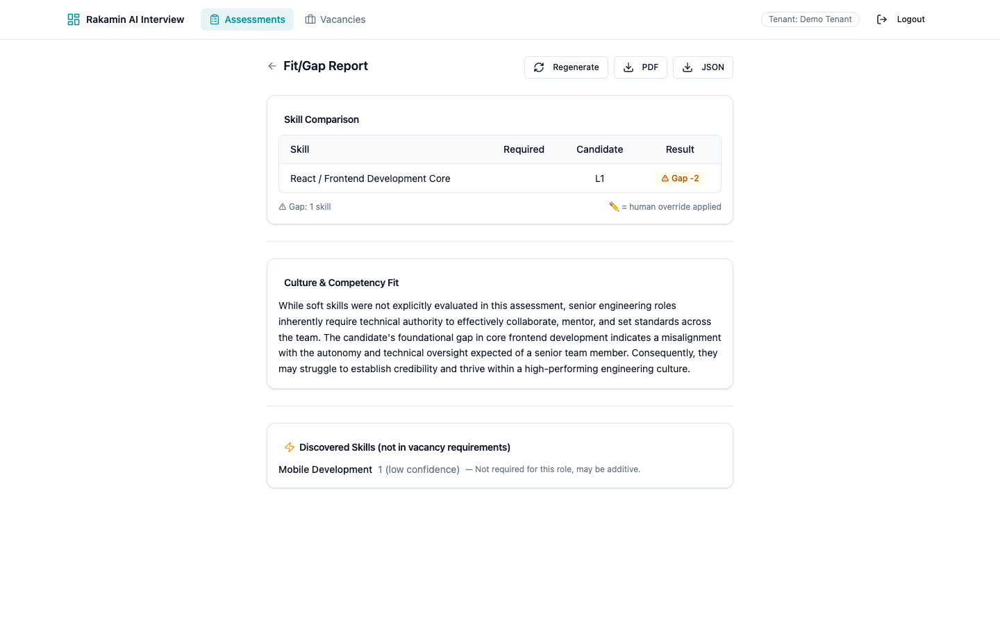
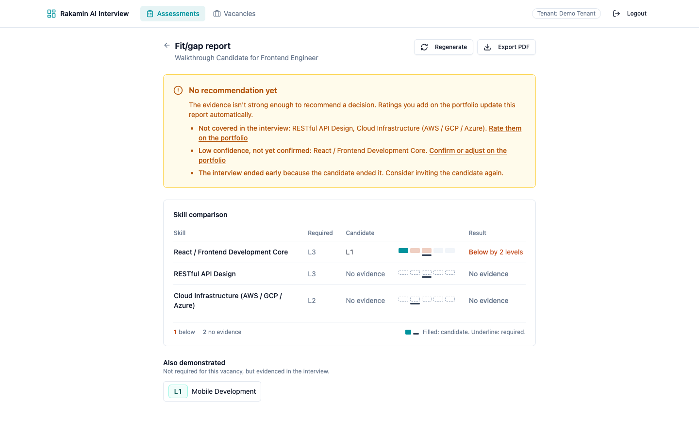
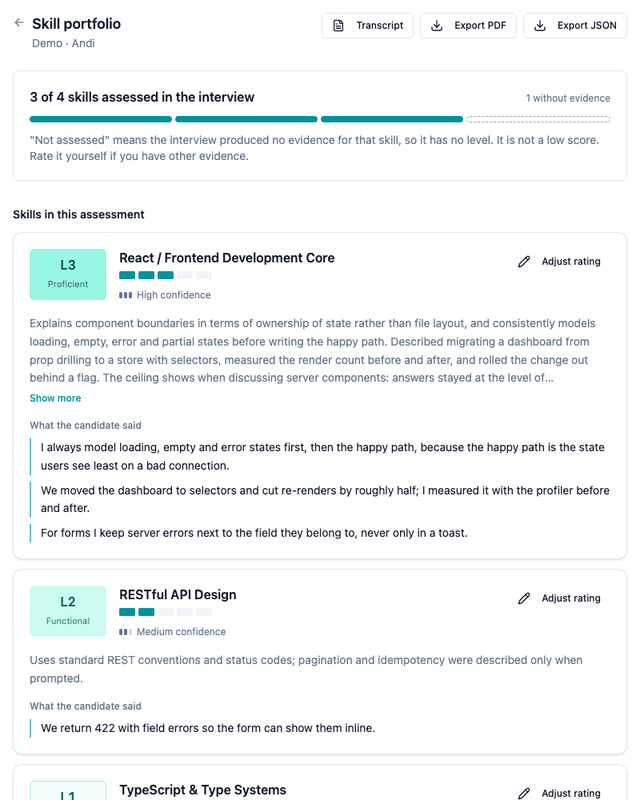
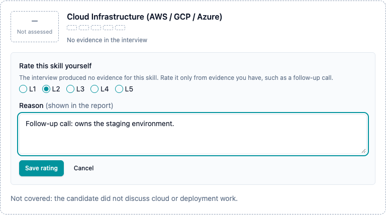
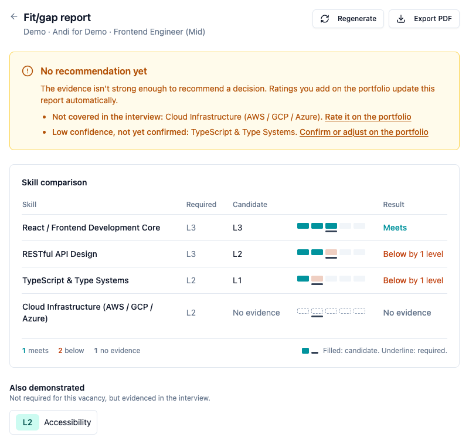
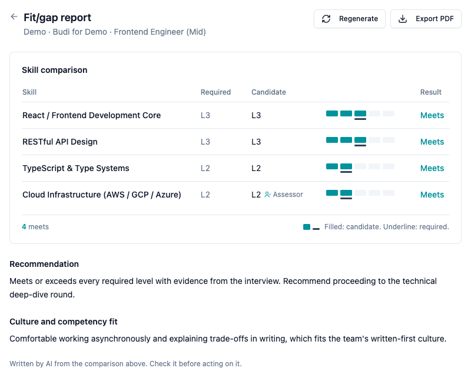
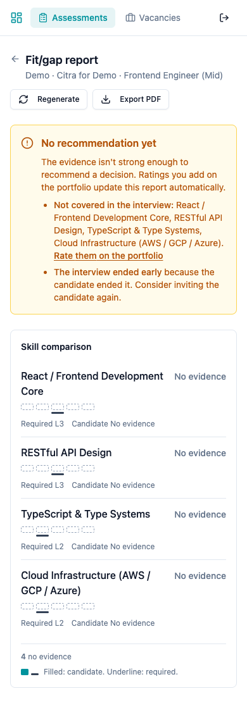
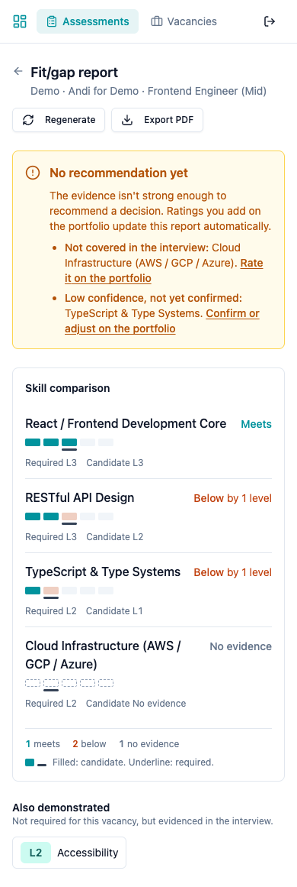
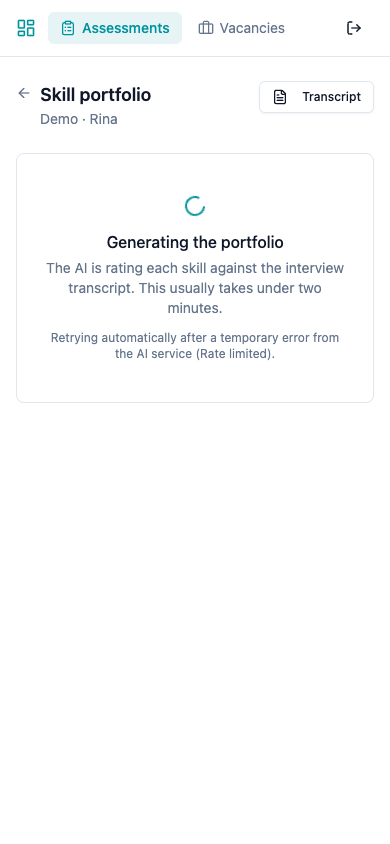
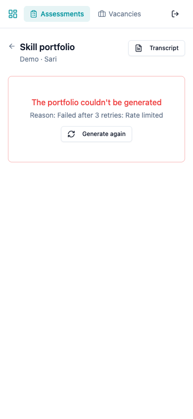

# Honest Skill Evaluation

**Case study: Fullstack Product Engineer · Rakamin AI Interview Platform**

- **Pull request:** https://github.com/rakamindev/ai-interview-platform/pull/176 (seeded-fault history: https://github.com/rikopernando/ai-interview-platform/commits/scratch/seeded-fault)
- **Video walkthrough:** https://www.loom.com/share/59805472fe524434b30bf85745579615 (Bahasa Indonesia, about 3 min)
- **Claimed depth: frontend-heavy.** The report UX is rebuilt around evidence, with every state handled and 44 component/page tests. The backend module is smaller but complete: migration, scoring rules, evidence gate, API contract, 121 specs.
- **Detail documents** (in the repository): `assessment/01-context.md`, `02-findings.md`, `03-strategy.md`, `04-verification.md`, `ai-notes.md`

---

## The problem in one sentence

> **The product turns absence of evidence into evidence of absence.**

When an interview produces no signal about a skill, the platform still records a level (L1), compares it against the vacancy as a **gap**, and writes a confident **"do not recommend"**. In my first walkthrough, a candidate who ended the interview after **3 minutes 19 seconds** got two L1 ratings and the verdict *"we do not recommend proceeding with this candidate."* The AI's own summary for one of those skills said it was *"not discussed in detail"*.

**Before: original code, real session.** The Required column is blank. The "do not recommend" verdict is hidden; only a culture paragraph shows, predicting the candidate *"may struggle to establish credibility"* although soft skills *"were not explicitly evaluated."*

**After: same session, new code.** No verdict. The page says what is missing (two skills never covered, one low-confidence rating, an interview the candidate ended) and links to where each can be resolved. No model call was made.

---

## Step 1 · Setup and local exploration

I ran both services locally and explored them as an assessor and as a candidate. Setup surfaced problems before any product work, and I logged each one as a finding:

- The **dev/test database names pointed at the shared `rakamin_*` databases**. `db:test:prepare` would have wiped the other service's test data, so I renamed them first (F-023).
- The **sample Gemini models no longer exist**. The REST client is pinned to `v1`, where no Pro model is served (F-024).
- **No login user is seeded** (F-025), the `bin/` scripts aren't executable (F-026), and ports and URLs don't match (F-027).
- The **candidate network check blocked my own working connection**: "1.77 Mbps — Failed". The code computes megabytes per second and compares it to a megabits threshold, under-reporting 8×, and times the upload against a US echo server (F-007).

I then ran **two real interviews**. The second one surfaced three more defects live:
- 13 Gemini `503` errors with **zero retries**, because the retry configuration never applies to POST (F-008).
- The session **ended as `all_covered` with nothing covered**, after the AI said a closing phrase (F-006).
- **Two Retry clicks started two concurrent generation jobs** (F-009).

## Step 2 · Context and domain

*Full version: `01-context.md`.*

- **The product:** an AI voice interviewer that turns a 10–60 minute conversation into skill ratings, a fit/gap comparison against a vacancy, and a hiring recommendation.
- **The industry:** early screening in Indonesia is high-volume, and assessor time is scarce. Transcription and summaries are commodities. **Trust is the product**: a rating a hiring manager is willing to act on and defend. Once a recruiter catches the tool scoring something it never measured, every score loses value.
- **The users:** assessors need evidence and a quick way to override. Recruiters need a comparison they can read in 30 seconds and defend. Hiring managers need to know whether a "gap" is real.
- **The candidates, who never chose it:** they cannot opt out, and a wrong rating changes their year. Under **UU PDP (UU 27/2022)**:
  - a fabricated L1 is *inaccurate personal data*;
  - AI skill levels and verdicts are *automated profiling* with significant effect (right to object, Art. 10);
  - voice and transcripts are *transferred to Google Gemini* without disclosure (Art. 56);
  - there is *no consent notice, retention policy or deletion path*.

## Step 3 · Problem and gap analysis

*Full version: `02-findings.md`, 31 findings, each with severity, impact, type and file:line.*

| ID | P | Type | Finding (one-line impact) |
|---|---|---|---|
| F-001 | P0 | Missing spec + defect | **Unassessed skills stored as L1**: candidates are scored on questions nobody asked |
| F-002 | P0 | Defect (seam) | **Fit/gap screen reads fields the API never sends**: blank Required column, invisible overrides, hidden recommendation |
| F-003 | P0 | Defect | **Cross-tenant access** to portfolios, exports, fit/gap and overrides by id |
| F-004 | P0 | Defect | Tenant resolved from client-controlled input; login lets the caller pick a tenant |
| F-030 | P0 | Defect | **The API cannot boot in production** (dead Active Job config and an autoloader naming mismatch). Found while adding CI |
| F-005 | P1 | Missing spec | **A recommendation is issued regardless of confidence or completeness** |
| F-006 | P1 | Defect | Sessions end as `all_covered` with nothing covered |
| F-007 | P1 | Defect | Network check under-reports speed 8× and blocks with no bypass |
| F-008 | P1 | Defect | Gemini failures swallowed; retries never fire |
| F-009 | P1 | Defect | Concurrent duplicate generation can delete assessor overrides |
| F-010 | P1 | Defect | Every candidate failure path says "Interview Complete — recorded" |
| F-011 | P1 | Defect | PDF export crashes whenever an override exists |
| F-012 | P1 | Missing spec + defect | Generation states that never resolve (infinite spinners) |
| F-013 | P1 | Defect | Model output parsed unsafely ("L3" → L1) |
| F-014 / F-015 | P1 | Missing spec / defect | No consent, retention or deletion; personal data in logs |

**Missing specification** (never defined): a "not assessed" rating; when evidence is too thin to recommend; status and recovery for generation; consent and retention.
**Defective implementation** (defined but broken): the L1 clamp, the API contract on the report screen, tenant isolation, end-of-interview rules, retries, the PDF encoding, form ids.
The core failure crosses **both services and the seam between them**.

### Constraint signal: what I would escalate to a Tech Lead

1. **Shared database with rakamin-api.** This repo migrates tables in another service's database. Who owns migrations?
2. **Tenant isolation is broken at the middleware, not per endpoint.** It needs an owner and a security review; patching endpoints one by one won't close it.
3. **The spec lives only in a wiki the code disagrees with.** I assumed a rating must be backed by evidence.
4. **No tests, no CI, an LLM in the critical path.** The clearest proof: **the codebase as handed over cannot boot in production**, and nothing would have caught it.
5. **AI capacity is a production dependency.** The free tier allows 20 requests/model/day, one interview makes about 20 coverage calls, and retries are silently disabled.
6. **UU PDP obligations** need legal and product sign-off, not just engineering.

## Step 4 · Strategy, acceptance criteria and trade-offs

*Full version: `03-strategy.md`.*

| | A · Frontend-only patch | **B · Evidence model end to end (chosen)** | C · Deterministic re-scoring |
|---|---|---|---|
| What | Fix field names; show "L1 + low" as "unclear" | Nullable level and "not assessed"; deterministic evidence gate; corrected contract; report UX rebuilt | Grade every turn against anchors |
| Buys | A readable table that still lies | Real gaps distinguished from missing measurements, consistently on screen, in the API and in the PDF | The most accurate levels |
| Cost | ~2 h | ~7–8 h | Days |
| Fails when | It guesses: a genuinely weak L1 gets mislabelled | The model returns a level on thin evidence. Mitigated: no quote, no level; low confidence gates the verdict; assessor override | Latency, cost, quota (already hit) |
| Walk-back | Trivial | Reversible migration | Hard |

**Why B:** the defect lives at five seams (prompt, parser, schema, rules, screen). Fixing one leaves the lie at the next, and B is the smallest change that makes all five agree.

**Decisions I would defend:**
- **"No quote, no level", not "coverage says not_yet".** My second interview disproved the original plan. A Gemini outage left coverage blank for every skill while the candidate answered at length, so a coverage-driven rule would have thrown away real evidence. Coverage is now only a hint in the prompt.
- **The recommendation gate is deterministic and runs before any model call.** The same model that wrote "do not recommend" from a 3-minute interview should not judge whether there is enough evidence to write one. The gate withholds a verdict when:
  - a required skill is not assessed;
  - a rating is low-confidence and not confirmed by an assessor;
  - the candidate ended the interview, or it errored;
  - the vacancy has no skills.

  An assessor's rating clears the first two. The rules live in one module, so the thresholds can be tuned with assessors.
- **"Not assessed" is NULL** (both level and confidence, enforced by a database CHECK). I rejected a sentinel 0 and a parallel status column.

**Acceptance criteria (AC1–AC16)** were written before code. Key edge cases:

| Input | Behaviour |
|---|---|
| Model returns `"L3"`, `3`, `3.0` | Stored as L3 |
| Model returns `null`, `"N/A"`, `0`, `6`, `3.7`, or a level with no quote | **Not assessed**, never L1 |
| Model omits a configured skill or invents one | Omitted → not assessed; invented → kept only if evidenced |
| Model answers with prose, an array or invalid JSON; Gemini 429/503 | Retried; previous skills and overrides untouched; `failed` with a reason only after the last retry |
| Retry clicked twice | One job (atomic claim; second click gets 409) |
| Candidate ends at 3 minutes; everything unassessed; vacancy with no skills | No recommendation, with reasons and next actions |
| Assessor rates a not-assessed skill | Comparison uses the assessor's level, marked "Assessor"; the gate clears for that skill |
| Another tenant's portfolio id | 404 |
| Evidence with `→`, emoji, very long text | PDF exports; UI clamps with "Show more"; no overflow at 390 px |

## Step 5 · Implementation (Monozukuri) and verification

**Backend:**
- reversible migration;
- `RatingParser` and `SkillReconciler` (evidence or nothing);
- transactional generator that keeps `generating` during retries and skips the model when the candidate never spoke;
- `EvidenceGate`;
- tenant-scoped portfolio endpoints;
- encoding-safe PDF that explains a withheld verdict;
- deterministic demo seed for every state.

**Frontend:** (design rationale in `03-strategy.md` §10)
- An **evidence visual language** inside the existing tokens: teal for evidence, slate for required, orange for a measured gap (red stays for errors), amber for missing evidence, dashed grey for none.
- One recurring element, the **`LevelTrack`**: five rungs, candidate filled, required underlined. "No evidence" is drawn dashed and empty, so it can never read as L1.
- Level badges use one teal ramp; the old grey L1 looked like "empty".
- Every state handled; mobile stacked layout; keyboard and screen-reader labels.

| Proof | Result |
|---|---|
| API specs | **121 examples, 0 failures** (no network; fake Gemini) |
| Web tests | **44 passed** (component and page states, regression tests for F-002, F-012, F-016) |
| **Seeded fault** (`scratch/seeded-fault`, history visible) | Original parser and field name reintroduced → **33 API specs and the web regression test fail**; revert → all pass, tree identical |
| Tests written before fixes | Failed against the original code: 4 cross-tenant specs (F-003) and 3 PDF specs (`IncompatibleStringEncoding`, F-011) |
| Migration | up → down → up on real rows; `down` verified with a not-assessed row present |
| Production boot | `RAILS_ENV=production` boots; `zeitwerk:check` passes; CI eager-loads |
| CI | `.github/workflows/ci.yml`: RSpec with eager loading, web lint, test and build |
| Live end-to-end | Not run with the fixed code: the Gemini free tier (20 requests a day per model) ran out. Session 1 is a real interview recorded before the fix, and its fit/gap report was regenerated by the new code (before/after screenshots). Every other state is covered by specs and the demo seed. |

**Defence in depth, visible in the seeded-fault run:** with the parser broken, the generator's integration spec *still passed*. The second guard, "no quote, no level", recorded the invented L1 as not assessed anyway. Either guard alone stops the original defect.

### AI verification moments

*Full log: `ai-notes.md`, 8 entries.* I used AI (Claude Code) for surveys, drafting and implementation, and verified every claim before relying on it. Three cases where it was wrong:

1. **A migration with a broken rollback.** `up → down → up` passed on the dev database, so it looked reversible. I re-ran `down` *with a not-assessed row present*, the case the migration exists for, and it failed with `PG::CheckViolation`: it backfilled the level before dropping the new consistency constraint. Fixed and re-verified.
2. **UI that passed every test but was broken on a phone.** 44 tests were green. Opening the pages in a browser at 390 px showed the header overflowing to 550 px and a skill name running under a button. Fixed, and the screenshot script now fails on any horizontal overflow.
3. **A prediction about the interview that the runtime contradicted.** The AI predicted the session would end by itself at 10 minutes, based on the prompt's rules. It ended at 8:24 as `all_covered` because a runtime fallback overrides those rules. The miss exposed F-006.

## Step 6 · Screenshots

*All 22 states at 1440 px and 390 px: `assessment/screenshots/` (generated by `npm run screenshots` from the demo seed).*

| Portfolio: mixed evidence | Rating a skill the interview missed |
|---|---|
|  |  |
| **Fit/gap: recommendation withheld** | **Fit/gap: recommendation allowed** |
|  |  |

| Nothing assessed (mobile) | Mixed evidence (mobile) | Generating, retrying (mobile) | Failed with reason (mobile) |
|---|---|---|---|
|  |  |  |  |

## Scope I deliberately left out

These are logged with proposed fixes in `02-findings.md`:
- the tenant middleware redesign (F-004);
- consent, retention and deletion (F-014);
- personal data in logs (F-015);
- the candidate "Interview Complete" on failure (F-010);
- the network check (F-007);
- the early-end fallback (F-006);
- the coverage state machine (F-018).

Each is real, but none fits a 1–2 day slice without shortchanging the core problem. Several need product or legal decisions first.

## Assumptions

1. **A rating must be backed by evidence.** The spec wiki wasn't available; where it is silent, the system says "not assessed" rather than guessing.
2. **The evidence-gate rules are a product default** to be tuned with assessors, not a final policy.
3. **An assessor's rating is human evidence** and may stand in for missing AI evidence.
4. **Timeline:** the brief's deadline (Wednesday 19 August) had passed when I received it; I worked to a 1–2 day window.
5. **Gemini free tier:** live verification is limited by quota; the deterministic seed and fake client carry the test burden.
6. **One comprehensive PR** (brief Option A): one theme across both services, with commits layered so it reads bottom-up.
